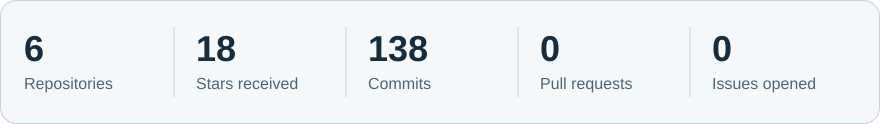

<picture>
  <source media="(max-width: 600px) and (prefers-color-scheme: dark)" srcset="./assets/profile-header-mobile.svg" />
  <source media="(max-width: 600px) and (prefers-color-scheme: light)" srcset="./assets/profile-header-mobile-light.svg" />
  <source media="(prefers-color-scheme: dark)" srcset="./assets/profile-header.svg" />
  <source media="(prefers-color-scheme: light)" srcset="./assets/profile-header-light.svg" />
  
</picture>

<picture>
  <source media="(max-width: 600px) and (prefers-color-scheme: dark)" srcset="./assets/section-activity-mobile.svg" />
  <source media="(max-width: 600px) and (prefers-color-scheme: light)" srcset="./assets/section-activity-mobile-light.svg" />
  <source media="(prefers-color-scheme: dark)" srcset="./assets/section-activity.svg" />
  <source media="(prefers-color-scheme: light)" srcset="./assets/section-activity-light.svg" />
  
</picture>

<picture>
  <source media="(max-width: 600px) and (prefers-color-scheme: dark)" srcset="https://raw.githubusercontent.com/therabo/therabo/output/stats/activity-card-mobile.svg" />
  <source media="(max-width: 600px) and (prefers-color-scheme: light)" srcset="https://raw.githubusercontent.com/therabo/therabo/output/stats/activity-card-mobile-light.svg" />
  <source media="(prefers-color-scheme: dark)" srcset="https://raw.githubusercontent.com/therabo/therabo/output/stats/activity-card.svg" />
  <source media="(prefers-color-scheme: light)" srcset="https://raw.githubusercontent.com/therabo/therabo/output/stats/activity-card-light.svg" />
  
</picture>

<picture>
  <source media="(max-width: 600px) and (prefers-color-scheme: dark) and (prefers-reduced-motion: reduce)" srcset="https://raw.githubusercontent.com/therabo/therabo/output/contributions/contribution-invaders-mobile-static-dark.svg" />
  <source media="(max-width: 600px) and (prefers-color-scheme: light) and (prefers-reduced-motion: reduce)" srcset="https://raw.githubusercontent.com/therabo/therabo/output/contributions/contribution-invaders-mobile-static-light.svg" />
  <source media="(max-width: 600px) and (prefers-color-scheme: dark)" srcset="https://raw.githubusercontent.com/therabo/therabo/output/contributions/contribution-invaders-mobile-dark.svg" />
  <source media="(max-width: 600px) and (prefers-color-scheme: light)" srcset="https://raw.githubusercontent.com/therabo/therabo/output/contributions/contribution-invaders-mobile-light.svg" />
  <source media="(prefers-color-scheme: dark) and (prefers-reduced-motion: reduce)" srcset="https://raw.githubusercontent.com/therabo/therabo/output/contributions/contribution-invaders-static-dark.svg" />
  <source media="(prefers-color-scheme: light) and (prefers-reduced-motion: reduce)" srcset="https://raw.githubusercontent.com/therabo/therabo/output/contributions/contribution-invaders-static-light.svg" />
  <source media="(prefers-color-scheme: dark)" srcset="https://raw.githubusercontent.com/therabo/therabo/output/contributions/contribution-invaders-dark.svg" />
  <source media="(prefers-color-scheme: light)" srcset="https://raw.githubusercontent.com/therabo/therabo/output/contributions/contribution-invaders-light.svg" />
  
</picture>

<picture>
  <source media="(max-width: 600px) and (prefers-color-scheme: dark)" srcset="./assets/section-contact-mobile.svg" />
  <source media="(max-width: 600px) and (prefers-color-scheme: light)" srcset="./assets/section-contact-mobile-light.svg" />
  <source media="(prefers-color-scheme: dark)" srcset="./assets/section-contact.svg" />
  <source media="(prefers-color-scheme: light)" srcset="./assets/section-contact-light.svg" />
  
</picture>

  <a href="https://www.linkedin.com/in/therabo/" title="LinkedIn profile">
    <picture>
      <source media="(prefers-color-scheme: dark)" srcset="./assets/contact-linkedin.svg" />
      <source media="(prefers-color-scheme: light)" srcset="./assets/contact-linkedin-light.svg" />
      
    </picture>
  </a>&nbsp;&nbsp;&nbsp;
  <a href="https://t.me/callmeda" title="Telegram contact">
    <picture>
      <source media="(prefers-color-scheme: dark)" srcset="./assets/contact-telegram.svg" />
      <source media="(prefers-color-scheme: light)" srcset="./assets/contact-telegram-light.svg" />
      
    </picture>
  </a>

